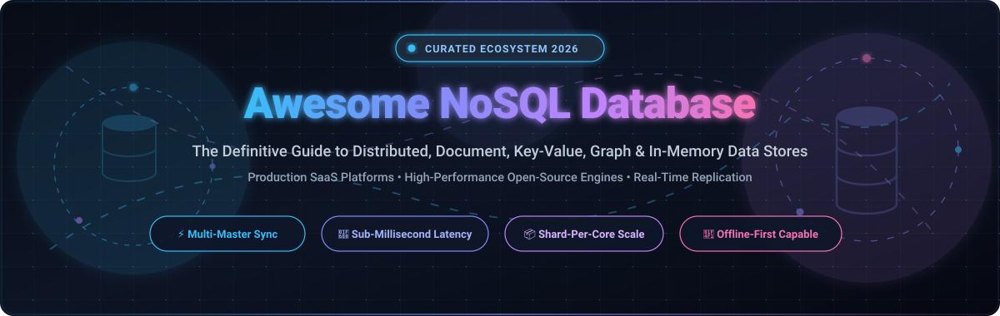

# 🚀 Awesome NoSQL Database

> A curated directory and architectural guide to world-class **NoSQL Databases** — covering distributed document stores, in-memory key-value caches, wide-column engines, multi-model graph platforms, and vector data stores.

  
  
  
  
  
  

---

## 📑 Table of Contents

- [🌐 Sector Overview & Market Dynamics](#-sector-overview--market-dynamics)
- [🏢 SaaS & Managed Cloud NoSQL Platforms](#-saas--managed-cloud-nosql-platforms)
- [💻 Open-Source GitHub Projects](#-open-source-github-projects)
- [📊 Quick Architectural Comparison](#-quick-architectural-comparison)
- [🔍 Key NoSQL Paradigms Explained](#-key-nosql-paradigms-explained)
- [🤝 How to Contribute](#-how-to-contribute)
- [⭐ Star History](#-star-history)
- [💖 Support & Sponsoring](#-support--sponsoring)
- [📜 Disclaimer](#-disclaimer)

---

## 🌐 Sector Overview & Market Dynamics

The global **NoSQL database market** was valued at approximately **$12.5 billion in 2024** and is projected to surpass **$38.4 billion by 2030**, exhibiting a compound annual growth rate (**CAGR**) of **21.5% to 26.8%**. This rapid expansion is driven by exponential growth in unstructured generative AI datasets, real-time edge processing, high-dimensional vector embeddings, and globally distributed mobile backends that outgrow traditional relational schema constraints.

The sector demonstrates **moderate concentration at the infrastructure platform tier**—dominated by cloud hyperscalers (*Amazon DynamoDB*, *Microsoft Azure Cosmos DB*, *Google Cloud Firestore*) and pioneer pure-play vendors (*MongoDB Atlas*) capturing large enterprise production footprints. Conversely, the market remains **highly fragmented across the underlying database engine tier**, where specialized distributed architectures (*Apache Cassandra*, *Apache CouchDB*, *Redis/Valkey*, *ScyllaDB*, *SurrealDB*, *Milvus*, *Aerospike*) fiercely compete on specific trade-offs including multi-master offline synchronization, sub-millisecond in-memory caching, graph traversal, and hardware-saturating shard-per-core scalability.

---

## 🏢 SaaS & Managed Cloud NoSQL Platforms

A comprehensive comparison of top hosted and serverless NoSQL database platforms, evaluated by corporate market capitalization / valuation, transparent starting tier rates, and exact free-tier allocations. Sorted in **descending order by company scale**.

| 🏢 Platform / Service | 📈 Company Scale (Valuation / Revenue) | 💵 Starting Pricing Tier (Specific Rates) | 🎁 Free Tier & Trial Limits | 🎯 Core Architecture & Best Use Case |
| :--- | :--- | :--- | :--- | :--- |
| **[Microsoft Azure Cosmos DB](https://azure.microsoft.com/en-us/products/cosmos-db/)** | **~$3.1 Trillion** Market Cap *(Microsoft FY24 Revenue: $245.1B)* | **Serverless**: $0.25 per 1M RUs (Request Units) + $0.25/GB storage/mo. **Provisioned**: Starts at $0.008/hr per 100 RU/s (~$5.84/mo). | **Lifetime Free Tier**: 1,000 RU/s provisioned throughput + 25 GB storage free every month forever (saves ~$40/mo per account). | Multi-model (Document, Key-Value, Graph via Gremlin, Cassandra, Table) with SLA-backed 99.999% high availability and multi-region replication. |
| **[Google Cloud Firestore](https://cloud.google.com/firestore)** | **~$2.1 Trillion** Market Cap *(Alphabet FY24 Revenue: $307.4B)* | **Pay-as-you-go**: $0.06 per 100,000 document reads, $0.18 per 100,000 document writes, $0.02 per 100,000 document deletes; $0.18/GB storage/mo. | **Always Free Tier**: 1 GB stored data, 50,000 document reads/day, 20,000 writes/day, 20,000 deletes/day free forever (plus $300 90-day GCP trial credit). | Serverless document database engineered for real-time mobile/web sync, client listeners, and automatic multi-region consistency. |
| **[Amazon DynamoDB](https://aws.amazon.com/dynamodb/)** | **~$2.0 Trillion** Market Cap *(Amazon FY24 Revenue: $620.1B)* | **On-Demand**: $1.25 per million write request units, $0.25 per million read request units, $0.25/GB storage/mo. **Provisioned**: $0.00065/hr per WCU, $0.00013/hr per RCU. | **AWS Always Free Tier**: 25 GB storage, 25 provisioned Write Capacity Units (WCU), 25 provisioned Read Capacity Units (RCU)—handling up to ~200M requests/mo free forever. | Predictable single-digit millisecond latency key-value and document store, seamlessly integrated across the AWS serverless ecosystem. |
| **[MongoDB Atlas](https://www.mongodb.com/products/platform/atlas-database)** | **~$22.0 Billion** Market Cap *(MongoDB Inc. FY24 Revenue: $1.68B)* | **Shared Flex / M2**: $0.012/hr (~$9/mo); **M5**: $0.034/hr (~$25/mo). **Dedicated M10**: Starts at $0.08/hr (~$56.94/mo). **Serverless**: $0.10/1M reads, $1.00/1M writes, $0.25/GB/mo. | **Shared M0 Cluster**: 512 MB storage, shared RAM/vCPU, TLS/SSL encryption, automated security patches free forever (no credit card required). | Industry standard JSON-like document store with expressive aggregation pipelines, Atlas Vector Search, and multi-cloud cluster options. |
| **[Redis Cloud](https://redis.io/cloud/)** | **~$4.0 Billion** Valuation *(Redis Ltd. Private, Series G)* | **Pay-as-you-go**: Starts at $0.015/hr (~$10.95/mo for 250 MB fixed memory) or $0.881/GB/hr for flexible dynamic memory. | **Free Forever Plan**: 30 MB database storage, 1 database instance, up to 30 concurrent connections, high availability free forever. | Ultra-low latency in-memory data store for distributed caching, session stores, messaging pub/sub, and streaming state. |
| **[DataStax Astra DB](https://www.datastax.com/products/datastax-astra)** | **~$1.6 Billion** Valuation *(DataStax Private, Series G)* | **Pay-as-you-go**: $1.50 per 1M read operations, $2.00 per 1M write operations, $0.25/GB-month storage. | **$25 Recurring Monthly Credit**: Free every month forever, covering ~80M reads, 10M writes, and 100 GB storage monthly (plus 30-day enterprise trial). | Serverless Apache Cassandra database with integrated vector search API for high-throughput AI retrieval and globally distributed workloads. |
| **[Couchbase Capella](https://www.couchbase.com/products/capella/)** | **~$1.1 Billion** Market Cap *(Couchbase Inc. FY24 Revenue: $180M+)* | **Developer Pro / Basic**: Starts at $0.27/node/hour (~$197/mo for single-node cluster) with integrated SQL++ (JSON SQL) engine. | **30-Day Free Trial**: 1 fully functional 3-node cluster, pre-loaded sample datasets, no credit card required, full SQL++ querying and full-text search. | Hybrid memory-first document store combining familiar SQL queries with high-speed key-value cache and built-in mobile synchronization. |
| **[ScyllaDB Cloud](https://www.scylladb.com/cloud/)** | **~$300 Million** Valuation *(ScyllaDB Inc. Private, Series C)* | **Dedicated Clusters**: Starts at $0.24/hour (~$175/mo for 3-node i3en.large equivalent or BYOC deployment). | **30-Day Free Trial**: Fully managed 3-node cluster, 10,000 IOPS, 50 GB storage, CQL shell access, no credit card required. | C++ rewrite of Cassandra with shard-per-core asynchronous architecture delivering consistent p99 sub-millisecond latencies under extreme scale. |
| **[Fauna](https://fauna.com/)** | **~$150 Million** Valuation *(Fauna Inc. Private, Series B)* | **Starter / Pro**: $25/mo base fee + $0.15/1M read ops, $0.45/1M write ops, $0.25/GB storage. | **Free Forever Tier**: 100,000 daily read ops, 50,000 daily write ops, 500 MB storage, and 5 GB monthly data transfer free forever. | Globally distributed document-relational database with strong ACID transactions, GraphQL/FQL querying, and zero infrastructure provisioning. |

---

## 💻 Open-Source GitHub Projects

Explore leading open-source NoSQL engines spanning document stores, key-value caches, wide-column engines, vector databases, and multi-model platforms. **Sorted in strictly descending order by GitHub_Stars_Count.**

1. ### ⚡ [Redis](https://github.com/redis/redis) 
   - **Type**: In-Memory Key-Value / Data Structure Store
   - **Stars**: ~77,000+ ⭐
   - **License**: Redis Source Available License (RSALv2) / SSPLv1
   - **Highlights**: The world's most ubiquitous in-memory datastore. Delivers microsecond responses with rich built-in data types (Strings, Hashes, Lists, Sets, Sorted Sets, Bitmaps, HyperLogLogs, Geospatial, Streams).
   - **Best For**: Real-time caching, session management, leaderboard calculations, and publish/subscribe message brokering.

2. ### 🔍 [Meilisearch](https://github.com/meilisearch/meilisearch) 
   - **Type**: Document Search Engine / Key-Value Store
   - **Stars**: ~59,600+ ⭐
   - **License**: MIT
   - **Highlights**: Ultra-fast, typo-tolerant search and document database written in Rust. Features out-of-the-box search-as-you-type, multi-attribute filtering, faceted search, and hybrid vector search.
   - **Best For**: E-commerce catalog search, SaaS customer-facing search bars, and instant document querying.

3. ### 🌐 [etcd](https://github.com/etcd-io/etcd) 
   - **Type**: Distributed Key-Value Store (Consensus-Backed)
   - **Stars**: ~52,400+ ⭐
   - **License**: Apache 2.0
   - **Highlights**: Strongly consistent, distributed key-value store powered by the Raft consensus algorithm. Serves as the bedrock state storage for Kubernetes clusters worldwide.
   - **Best For**: Configuration management, leader election, distributed locking, and service discovery in cloud-native orchestrators.

4. ### 🧠 [Milvus](https://github.com/milvus-io/milvus) 
   - **Type**: Cloud-Native Vector NoSQL Database
   - **Stars**: ~46,400+ ⭐
   - **License**: Apache 2.0
   - **Highlights**: Engineered specifically for high-dimensional vector similarity search and unstructured data retrieval. Decouples storage from compute with support for billion-vector collections.
   - **Best For**: LLM retrieval-augmented generation (RAG), multimodal search, image/audio similarity, and recommendation engines.

5. ### 🚀 [Qdrant](https://github.com/qdrant/qdrant) 
   - **Type**: Vector Search Engine & Document Payload Store
   - **Stars**: ~35,200+ ⭐
   - **License**: Apache 2.0
   - **Highlights**: Written in Rust for maximum memory safety and raw hardware performance. Features filterable vector indexing, hardware-accelerated quantization (INT8), and rich JSON payload storage.
   - **Best For**: Production AI agents, semantic document search, recommendation systems, and neural search pipelines.

6. ### 🌌 [SurrealDB](https://github.com/surrealdb/surrealdb) 
   - **Type**: Multi-Model (Document, Graph, Relational, Temporal)
   - **Stars**: ~33,200+ ⭐
   - **License**: Business Source License (BSL 1.1) / Apache 2.0 community components
   - **Highlights**: Cloud-native database written in Rust. Unifies document flexibility, graph relationships, and SQL-like querying with SurrealQL, WebSocket subscriptions, and row-level permissions.
   - **Best For**: Full-stack Jamstack/web applications, real-time collaboration apps, and unified graph-document modeling.

7. ### 🪨 [RocksDB](https://github.com/facebook/rocksdb) 
   - **Type**: Embedded Key-Value Storage Engine
   - **Stars**: ~32,200+ ⭐
   - **License**: Apache 2.0 / BSD 3-Clause
   - **Highlights**: Meta's high-performance embedded key-value store based on Log-Structured Merge (LSM) trees. Built for lightning-fast reads and writes on flash/NVMe drives; serves as the underlying storage engine for CockroachDB, TiKV, Kafka Streams, and MySQL MyRocks.
   - **Best For**: Custom high-throughput storage engines, embedded device datastores, and stream-processing state backends.

8. ### 🍃 [MongoDB](https://github.com/mongodb/mongo) 
   - **Type**: Distributed Document Store
   - **Stars**: ~28,700+ ⭐
   - **License**: Server Side Public License (SSPL v1)
   - **Highlights**: The most popular document database in software development. Stores data in BSON format, supports dynamic schemas, ad-hoc queries, indexing, and the powerful Aggregation Pipeline.
   - **Best For**: Rapid prototyping, e-commerce product catalogs, enterprise content management, and operational logging.

9. ### 🛡️ [Valkey](https://github.com/valkey-io/valkey) 
   - **Type**: In-Memory Key-Value Datastore
   - **Stars**: ~27,500+ ⭐
   - **License**: BSD-3-Clause (Open Source Initiative compliant)
   - **Highlights**: The community-governed, Linux Foundation-backed open-source fork of Redis created following Redis's 2024 license shift. Fully backwards-compatible with drop-in protocol support and active community development.
   - **Best For**: Mission-critical caching, session management, and microservice coordination requiring strictly OSI-compliant licensing.

10. ### 🔄 [RethinkDB](https://github.com/rethinkdb/rethinkdb) 
    - **Type**: Real-Time JSON Document Store
    - **Stars**: ~27,000+ ⭐
    - **License**: Linux Foundation / Apache 2.0
    - **Highlights**: The open-source database for the real-time web. Pioneers **Changefeeds**—instead of polling for changes, developers can subscribe to real-time continuous feeds of query updates pushed immediately over WebSockets.
    - **Best For**: Collaborative whiteboards, live multiplayer games, IoT dashboards, and real-time chat feeds.

11. ### 📱 [PouchDB](https://github.com/pouchdb/pouchdb) 
    - **Type**: In-Browser & Node.js Offline-First Document Store
    - **Stars**: ~17,600+ ⭐
    - **License**: Apache 2.0
    - **Highlights**: An in-browser JavaScript database designed to emulate the CouchDB API. Enables applications to store data locally offline in IndexedDB and synchronize bi-directionally with remote CouchDB instances once connected.
    - **Best For**: Offline-first progressive web apps (PWAs), field service mobile applications, and weak-connectivity tools.

12. ### 🕸️ [Neo4j Community](https://github.com/neo4j/neo4j) 
    - **Type**: Native Graph Database
    - **Stars**: ~17,400+ ⭐
    - **License**: GPL v3 / AGPL
    - **Highlights**: The leading native property graph database. Connects data points through nodes, relationships, and properties with pointer-chasing performance. Powered by the declarative Cypher query language.
    - **Best For**: Knowledge graphs, fraud ring detection, social networking topologies, and cybersecurity identity-and-access graphs.

13. ### ⚙️ [TiKV](https://github.com/tikv/tikv) 
    - **Type**: Distributed Transactional Key-Value Database
    - **Stars**: ~16,900+ ⭐
    - **License**: Apache 2.0 (CNCF Graduated Project)
    - **Highlights**: Written in Rust, TiKV provides ACID transactions across distributed clusters via Multi-Raft consensus. Powers the distributed storage layer of TiDB.
    - **Best For**: Financial-grade transactional state, distributed key-value backends, and hybrid transactional/analytical processing.

14. ### 🏎️ [ScyllaDB](https://github.com/scylladb/scylladb) 
    - **Type**: Wide-Column Distributed NoSQL Database
    - **Stars**: ~15,800+ ⭐
    - **License**: AGPL v3 / Apache 2.0
    - **Highlights**: C++ drop-in compatible replacement for Apache Cassandra. Implements a shared-nothing, asynchronous shard-per-core architecture that avoids Java garbage collection pauses and drives millions of IOPS per server.
    - **Best For**: High-throughput telemetry ingestion, ad-tech auction engines, and replacing high-maintenance Cassandra clusters.

15. ### 🥑 [ArangoDB](https://github.com/arangodb/arangodb) 
    - **Type**: Multi-Model NoSQL Database (Document, Graph, Key-Value)
    - **Stars**: ~14,300+ ⭐
    - **License**: Apache 2.0
    - **Highlights**: Native multi-model engine allowing developers to store documents, graphs, and key-values within a single database core and query across them using one unified query language (AQL).
    - **Best For**: Complex domain models mixing entity graphs with document payloads, hierarchical master data, and full-text search.

16. ### ⚡ [KeyDB](https://github.com/Snapchat/KeyDB) 
    - **Type**: High-Performance Multithreaded In-Memory Datastore
    - **Stars**: ~12,500+ ⭐
    - **License**: BSD-3-Clause
    - **Highlights**: Snapchat's multithreaded fork of Redis. Achieves up to 5x higher throughput by utilizing all available CPU cores, and offers active-replication with multi-master setups.
    - **Best For**: High-throughput Redis caching layers requiring maximum CPU core utilization and minimal instance counts.

17. ### 🏛️ [Apache Cassandra](https://github.com/apache/cassandra) 
    - **Type**: Distributed Wide-Column Store
    - **Stars**: ~10,100+ ⭐
    - **License**: Apache 2.0
    - **Highlights**: Masterless peer-to-peer distributed database originating from Amazon Dynamo and Google Bigtable papers. Guarantees zero single point of failure with tunable consistency and linear scale across multiple data centers.
    - **Best For**: Massive write-heavy time-series data, global IoT telemetry, and mission-critical multi-region deployments.

18. ### 🛋️ [Apache CouchDB](https://github.com/apache/couchdb) 
    - **Type**: Document Database with Multi-Master Sync
    - **Stars**: ~7,000+ ⭐
    - **License**: Apache 2.0
    - **Highlights**: The pioneer of seamless multi-master bi-directional replication. Uses an append-only B-tree storage engine, exposes an intuitive HTTP/JSON REST API, and resolves replication conflicts gracefully across decentralized topologies.
    - **Best For**: Offline-first applications, decentralized systems, mobile-to-cloud synchronization, and distributed office networks.

19. ### 🐘 [Apache HBase](https://github.com/apache/hbase) 
    - **Type**: Distributed Wide-Column Big Data Store
    - **Stars**: ~5,600+ ⭐
    - **License**: Apache 2.0
    - **Highlights**: Open-source implementation of Google's Bigtable, running on top of Hadoop HDFS. Provides random real-time read/write access to tables holding billions of rows and millions of columns.
    - **Best For**: Hadoop analytics ecosystems, massive data lake ingestion, and historical record repositories.

20. ### 🦅 [RavenDB](https://github.com/ravendb/ravendb) 
    - **Type**: ACID Transactional Document Database
    - **Stars**: ~4,000+ ⭐
    - **License**: Fastlane / Commercial / Free Community
    - **Highlights**: Pioneer in providing fully transactional ACID guarantees across JSON documents. Includes automatic indexing via Lucene, multi-master cluster replication, and a rich built-in management studio.
    - **Best For**: Enterprise .NET backends, transactional document modeling, and zero-administration operations.

21. ### 🚀 [Aerospike](https://github.com/aerospike/aerospike-server) 
    - **Type**: Real-Time Hybrid Memory Multi-Model Store
    - **Stars**: ~1,400+ ⭐
    - **License**: AGPL v3 / Apache 2.0 client
    - **Highlights**: Optimized for Hybrid Memory Architecture (indexes kept in RAM while data is written straight to raw SSDs). Delivers predictable sub-millisecond latencies at petabyte scales with low server footprints.
    - **Best For**: Real-time bidding (RTB) ad exchanges, fraud detection algorithms, and high-frequency financial ledgers.

---

## 📊 Quick Architectural Comparison

| Category | Primary Engines | Data Model | Scalability Model | Consistency Type | Primary Strength |
| :--- | :--- | :--- | :--- | :--- | :--- |
| **Document Stores** | MongoDB, CouchDB, RavenDB | JSON / BSON Trees | Sharding & Replica Sets | Tunable / ACID / Eventual | Flexible schemas & nested querying |
| **Key-Value Caches** | Redis, Valkey, KeyDB, RocksDB | Key-Value / Hashes / Lists | Sharded Cluster / Embedded | In-Memory / Master-Replica | Microsecond read/write throughput |
| **Wide-Column Stores** | Cassandra, ScyllaDB, HBase | Rows with dynamic columns | Masterless Peer-to-Peer Ring | Tunable (QUORUM, ANY, ALL) | High write volume & linear expansion |
| **Multi-Model & Graph** | SurrealDB, ArangoDB, Neo4j | Graphs, Documents, Tables | Clustered Sharding / Master-Worker | ACID / Causal Consistency | Relationship traversals & unified queries |
| **Vector Databases** | Milvus, Qdrant | Vector Embeddings + Payloads | Cloud-Native Decoupled | Eventual / Read-Your-Writes | AI embedding similarity search (HNSW/IVF) |

---

## 🔍 Key NoSQL Paradigms Explained

### 1. 📄 Document Stores
Instead of splitting data across normalized SQL tables with foreign keys, document stores serialize related entities together in hierarchical JSON/BSON structures. This eliminates costly relational joins and accelerates development velocity for rapid schema changes.

### 2. ⚡ Multi-Master Replication & Offline-First Sync
In traditional single-master databases, network disconnection brings writes to a halt. In multi-master setups like **Apache CouchDB** and **PouchDB**, any node or mobile phone can independently record writes while offline. When network connectivity restores, peer-to-peer replication engines automatically synchronize revisions using conflict-detection trees.

### 3. 🏎️ Shard-Per-Core vs. Threaded Architectures
Modern engines like **ScyllaDB** abandon multi-threaded locking and OS context switching in favor of the Seastar C++ framework: each CPU core is assigned its own dedicated memory, NIC queue, and disk shard, maximizing NVMe drive utilization and eliminating tail-latency spikes.

---

## 🤝 How to Contribute

We welcome additions, corrections, and benchmark reports from the community!

1. 🍴 **Fork the repository** on GitHub.
2. 🌿 **Create a new branch**: `git checkout -b feature/add-nosql-engine`.
3. 📝 **Edit `README.md`**: Follow the existing format (include license, GitHub Stars_Badge, specific pricing, and architectural highlights).
4. 🚀 **Commit your changes**: `git commit -m "Add EngineName to Open-Source list"`.
5. 📤 **Push and create a Pull Request**: Submit your PR with a concise rationale.

---

## ⭐ Star History

---

## 💖 Support & Sponsoring

If you found this curated NoSQL database directory useful:
- ⭐ **Star this repository** on GitHub to help other engineers discover it!
- 🍴 **Fork and contribute** by submitting your favorite NoSQL tools, benchmarks, and guides.
- 📢 **Share with colleagues** and developer communities on Twitter/X, LinkedIn, Reddit, and Discord.
- ☕ **Support continuous maintenance**: Buy a coffee or become a sponsor on the [GitHub Sponsor Dashboard](https://github.com/sponsors/ishandutta2007). Every bit of support is deeply appreciated!

---

## 📜 Disclaimer

- This is an independent **community-curated directory** intended for software architects, backend engineers, and DevOps specialists. Listing here does not imply commercial endorsement.
- All brand names, logos, and trademarks belong to their respective corporate owners. Pricing and free tier allocations are based on publicly available documentation and may vary by cloud region.
- When selecting an open-source database, always review the project's current license (e.g., AGPL, SSPL, BSL vs. OSI-approved Apache 2.0 / MIT / BSD) to align with your organization's legal compliance policies.

---

  Maintained with ❤️ by <a href="https://github.com/ishandutta2007">Ishan Dutta</a> and the global open-source community.

